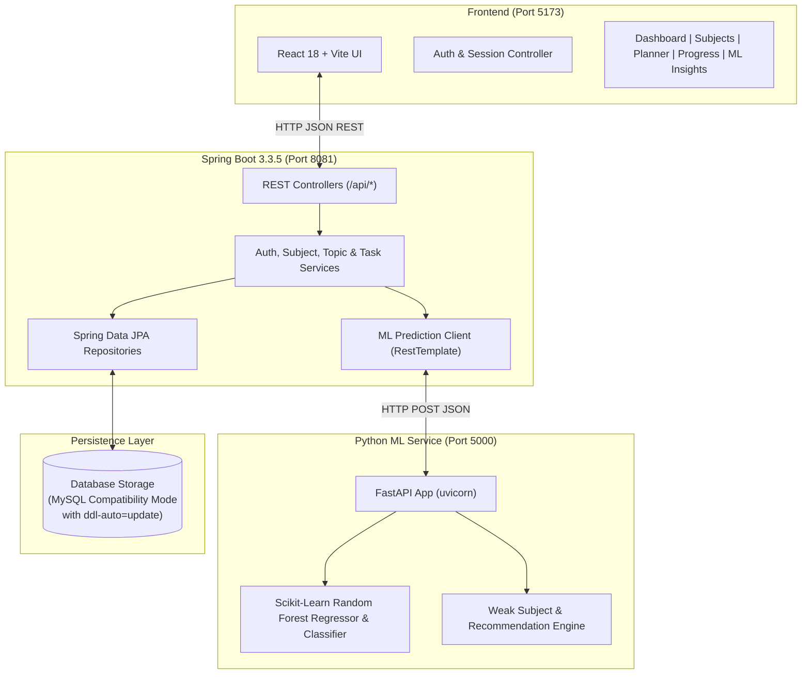

# Smart Study Planner & Learning Progress Tracker 🎓

[](https://react.dev/)
[](https://vitejs.dev/)
[](https://spring.io/projects/spring-boot)
[](https://www.oracle.com/java/)
[](https://www.python.org/)
[](https://fastapi.tiangolo.com/)
[](https://scikit-learn.org/)
[](https://www.mysql.com/)

A full-stack, AI/ML-driven academic management and student progress tracking ecosystem. It integrates a **React + Vite** frontend, a **Spring Boot 3 (Java 21)** REST API backend, and a **Python FastAPI (Scikit-Learn)** machine learning microservice to deliver real-time exam score predictions, weak subject vulnerability diagnosis, daily time-blocking study planners, and scientific spaced repetition revision schedules.

---

## 📑 Table of Contents

- [Key Features](#-key-features)
- [System Architecture](#-system-architecture)
- [Technology Stack](#-technology-stack)
- [Project Directory Structure](#-project-directory-structure)
- [Machine Learning Models & Logic](#-machine-learning-models--logic)
- [REST API Endpoints](#-rest-api-endpoints)
- [Installation & Getting Started](#-installation--getting-started)
- [Running Automated Test Suites](#-running-automated-test-suites)
- [Pre-Configured Demo Credentials](#-pre-configured-demo-credentials)
- [License](#-license)

---

## ✨ Key Features

### 1. 🔐 Authentication & Session Persistence
- **Secure Registration & Login**: Permanent user persistence with industry-standard **BCrypt password hashing** (strength 10).
- **Session Management**: Configurable "Remember Me" session persistence across browser reloads and restarts.
- **Strict Student Scoping**: Ensures each student strictly accesses only their own courses, topics, and tasks.

### 2. 📚 Subject & Syllabus Management
- **Course CRUD**: Create, edit, and delete university subjects with assigned course codes, faculty names, exam dates, and custom theme colors.
- **Granular Topic Breakdown**: Organize syllabus into individual topics.
- **Difficulty Grading**: Assign topic difficulty levels (`Easy`, `Medium`, `Hard`).
- **Real-Time Topic Status**: Track topics as `Not Started`, `In Progress`, or `Completed`.

### 3. 📅 Daily Study Planner
- **Time-Blocked Scheduling**: Plan daily focus blocks categorized by course and priority (`High`, `Medium`, `Low`).
- **Interactive Checklist**: Mark tasks completed with real-time status updates persisted directly to the database.
- **Dynamic Task Filters**: Filter tasks by day, completion status, or urgency.

### 4. 📈 Dynamic Progress Tracker
- **Holistic Summary Cards**: Live counts for *Total Topics*, *Completed Topics*, *Pending Topics*, and *Overall Progress %*.
- **Subject-Wise Progress Bars**: Visual completion bars for each course.
- **Topic Status Tags**: Clear badges identifying every syllabus item as *Completed* or *Pending*.
- **Auto-Sync**: Marking a topic complete in *My Subjects* instantly recalculates the entire *Progress Tracker*.

### 5. 🔁 Scientific Spaced Repetition (Revision Schedule)
- **Retention Algorithms**: Automated spaced intervals (Round 1: 1 Day, Round 2: 3 Days, Round 3: 7 Days, Round 4: 14 Days, Final: 30 Days).
- **Review Verification**: Mark revision rounds completed and assign confidence ratings to reinforce weak concepts before finals.

### 6. 🧠 AI/ML Insights & "What-If" Simulator
- **Student Performance Prediction**: Uses a trained **Random Forest Regressor** to predict final exam scores (0–100) and expected GPA (0.0–4.0).
- **Academic Risk Classification**: Classifies student status into `Low Risk`, `Medium Risk`, or `High Risk` using **Random Forest Classifier**.
- **Weak Subject Vulnerability Diagnosis**: Computes a diagnostic vulnerability score ($0-100\%$) for every course based on pending hard topics and days remaining until the exam.
- **Prescriptive Recommendations**: Generates personalized, actionable study recommendations to mitigate exam risks.
- **Interactive "What-If" Simulator**: Real-time interactive sliders allowing students to simulate how increasing weekly study hours or completing more syllabus topics directly impacts their predicted GPA and risk tier.

---

## 🏗 System Architecture



---

## 💻 Technology Stack

| Layer | Technologies Used |
| :--- | :--- |
| **Frontend** | React 18, Vite 5, Lucide React Icons, Canvas Confetti, Native CSS3 Design Tokens |
| **Backend** | Java 21, Spring Boot 3.3.5, Spring Data JPA, Hibernate ORM, Spring Security Crypto (BCrypt) |
| **Machine Learning** | Python 3.10+, FastAPI, Uvicorn, Scikit-Learn 1.4+, Pandas, NumPy, Joblib |
| **Database** | Persistent Disk Storage in MySQL compatibility mode (`MODE=MySQL`), ready for native MySQL 8.0 |
| **Testing** | JUnit 5, Mockito, Spring Boot Test, H2 In-Memory Driver, Oxlint |

---

## 📁 Project Directory Structure

```
smart study planner/
├── .gitignore                      # Top-level Git ignore rules (protects DB & secrets)
├── package.json                    # Frontend dependencies & npm scripts
├── vite.config.js                  # Vite bundler configuration
├── index.html                      # Single page application entry point
│
├── src/                            # REACT FRONTEND
│   ├── main.jsx                    # React DOM bootstrapper
│   ├── App.jsx                     # Top-level state, auth gate & view router
│   ├── index.css                   # Global CSS design system & responsive styling
│   ├── App.css                     # App-specific layout overrides
│   ├── assets/                     # Icons, illustrations, and images
│   ├── data/
│   │   └── sampleData.js           # Realistic seed fallback data
│   ├── utils/
│   │   ├── api.js                  # REST API client connecting to Spring Boot (Port 8081)
│   │   ├── auth.js                 # Session management & credential caching
│   │   └── storage.js              # Local persistence helper utilities
│   └── components/
│       ├── Sidebar.jsx             # Collapsible responsive navigation bar
│       ├── Header.jsx              # Search, notification badges & streak counter
│       ├── DashboardView.jsx       # Consolidated high-level overview
│       ├── SubjectsView.jsx        # Subject & syllabus topic CRUD management
│       ├── StudyPlannerView.jsx    # Time-blocked daily task manager
│       ├── ProgressTrackerView.jsx # Comprehensive topic mastery & completion breakdown
│       ├── RevisionScheduleView.jsx# 1-3-7-14 day spaced repetition tracker
│       ├── MlInsightsSection.jsx   # AI score prediction & What-If simulator UI
│       ├── SummaryCards.jsx        # Metric summary cards
│       ├── WelcomeBanner.jsx       # Personalized user greeting
│       └── auth/
│           ├── AuthPage.jsx        # Authentication landing & hero showcase
│           ├── LoginForm.jsx       # Sign in form with validation
│           ├── RegisterForm.jsx    # Student registration form
│           └── ForgotPasswordForm.jsx # Password recovery interface
│
├── backend/                        # SPRING BOOT BACKEND (Java 21)
│   ├── pom.xml                     # Maven project configuration & dependencies
│   ├── mvnw / mvnw.cmd             # Maven Wrapper scripts
│   ├── src/
│   │   ├── main/
│   │   │   ├── resources/
│   │   │   │   └── application.properties # Server port (8081), JPA, & DB settings
│   │   │   └── java/com/smartstudy/planner/
│   │   │       ├── SmartStudyPlannerApplication.java
│   │   │       ├── config/         # DataSeeder & ML RestTemplate configs
│   │   │       ├── controller/     # Auth, Subject, Topic, Task & ML Controllers
│   │   │       ├── dto/            # Request/Response Data Transfer Objects
│   │   │       ├── entity/         # JPA Entities (Student, Subject, Topic, StudyTask)
│   │   │       ├── exception/      # Global exception handlers & custom errors
│   │   │       ├── repository/     # Spring Data JPA query interfaces
│   │   │       └── service/        # Business logic & ML client integrations
│   │   └── test/                   # JUnit 5 integration & unit test suite (15 tests)
│   └── data/                       # Disk-persistent database storage (*.mv.db)
│
└── ml-service/                     # PYTHON AI/ML MICROSERVICE
    ├── main.py                     # FastAPI server exposing ML endpoints
    ├── train_model.py              # Scikit-learn Random Forest model training pipeline
    ├── test_service.py             # Automated testing script for all 5 ML capabilities
    ├── model.joblib                # Serialized trained model bundle
    └── .gitignore                  # Python-specific ignore rules
```

---

## 🤖 Machine Learning Models & Logic

The ML service is powered by **Scikit-Learn** and features genuine mathematical models:

1. **Exam Score Regressor (`RandomForestRegressor`)**:
   Trained on multi-dimensional academic metrics:
   $$\text{Score} = f(\text{Weekly Study Hours}, \text{Completion Ratio}, \text{Attendance Rate}, \text{Streak}, \text{Hard Topic Mastery})$$
2. **GPA Estimator (`RandomForestRegressor`)**:
   Maps predicted performance to academic Grade Point Average on a $4.0$ scale.
3. **Academic Risk Classifier (`RandomForestClassifier`)**:
   Labels students into `Low Risk`, `Medium Risk`, or `High Risk` categories.
4. **Weak Subject Diagnostic Formula**:
   $$\text{Vulnerability Score} = (0.50 \times \text{Incomplete Ratio}) + (0.30 \times \text{Hard Weight}) + (0.20 \times \text{Exam Urgency Factor})$$

---

## 📡 REST API Endpoints

### Authentication (`/api/auth`)
| Method | Endpoint | Description |
| :--- | :--- | :--- |
| `POST` | `/api/auth/register` | Register a new student account (BCrypt hashed) |
| `POST` | `/api/auth/login` | Authenticate student and return session profile |

### Subjects & Topics (`/api/subjects`, `/api/topics`)
| Method | Endpoint | Description |
| :--- | :--- | :--- |
| `GET` | `/api/subjects/student/{id}` | Fetch all subjects for a specific student |
| `POST` | `/api/subjects` | Create a new subject |
| `PUT` | `/api/subjects/{id}` | Update subject details |
| `DELETE` | `/api/subjects/{id}` | Remove subject and cascade delete topics |
| `POST` | `/api/topics/subject/{id}` | Add a topic under a subject |
| `PUT` | `/api/topics/{id}` | Update topic status or difficulty |
| `DELETE` | `/api/topics/{id}` | Delete a topic |

### Study Tasks (`/api/tasks`)
| Method | Endpoint | Description |
| :--- | :--- | :--- |
| `GET` | `/api/tasks/student/{id}` | Retrieve student's daily study tasks |
| `POST` | `/api/tasks` | Create a new study task |
| `PATCH` | `/api/tasks/{id}/toggle` | Toggle task completion status |
| `DELETE` | `/api/tasks/{id}` | Delete a study task |

### Machine Learning Insights (`/api/ml`)
| Method | Endpoint | Description |
| :--- | :--- | :--- |
| `GET` | `/api/ml/insights/student/{id}` | Full diagnostic evaluation & predictions |
| `POST` | `/api/ml/simulate` | Interactive "What-If" slider simulation |

---

## 🚀 Installation & Getting Started

### Prerequisites
- **Node.js** (v18.x or higher) and **npm**
- **Java Development Kit (JDK)** 21 installed
- **Python** (v3.10 or higher) with `pip`

---

### Step 1: Start the Python ML Service (Terminal 1)
```powershell
cd ml-service
pip install fastapi uvicorn scikit-learn pandas numpy joblib
python -m uvicorn main:app --host 0.0.0.0 --port 5000 --reload
```
*Verification:* Open `http://localhost:5000/health` in your browser. It will return:
```json
{
  "status": "UP",
  "service": "Smart Study Planner ML Service",
  "model_loaded": true,
  "engine": "Scikit-Learn / FastAPI"
}
```

---

### Step 2: Start the Spring Boot Backend (Terminal 2)
```powershell
cd backend
.\mvnw.cmd spring-boot:run
```
*(On macOS/Linux use `./mvnw spring-boot:run`)*  
The backend will boot on port **`8081`** and automatically initialize the persistent database file in `backend/data/`.

---

### Step 3: Start the React Frontend (Terminal 3)
```powershell
npm install
npm run dev
```
Open **`http://localhost:5173`** in your browser.

---

## 🧪 Running Automated Test Suites

All layers include rigorous automated tests:

### 1. Spring Boot Backend Tests (JUnit 5)
```powershell
cd backend
.\mvnw.cmd test
```
*Result:* **15 / 15 Tests Passed (0 Failures, 0 Errors)**.

### 2. Python Machine Learning Service Tests
```powershell
cd ml-service
python test_service.py
```
*Result:* **5 / 5 ML Diagnostic Endpoints Verified 100% OK**.

### 3. Frontend Code Quality & Production Build
```powershell
npm run lint
npm run build
```
*Result:* **0 warnings, 0 errors (`oxlint`)**; production bundle built cleanly in ~1.9s.

---

## 👤 Pre-Configured Demo Credentials

For quick evaluation and demonstrations, the database includes a pre-seeded student account:

- **Email:** `alex.morgan@university.edu`
- **Password:** `password123`

*(You can also use the **Create an account** tab to register any new student with customized subjects and tasks. All registered accounts are permanently stored in the database).*

---

## 📄 License

This project was built for academic evaluation and is licensed under the **MIT License**.
